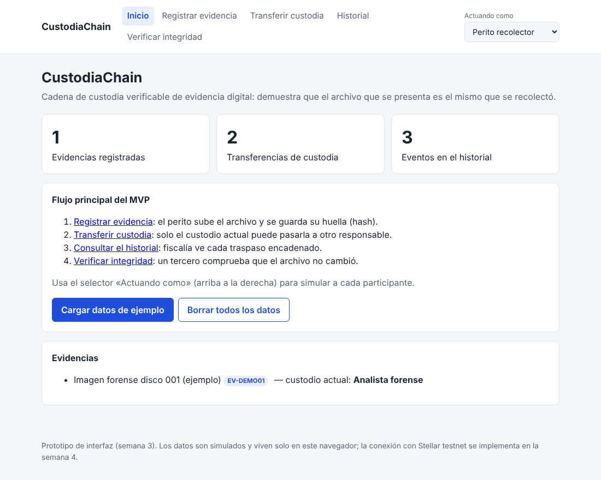
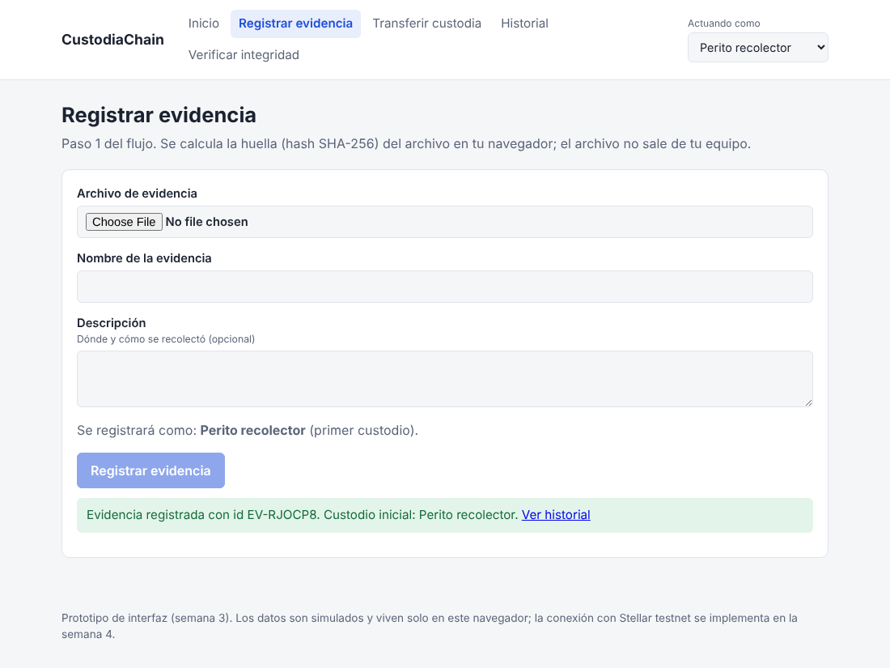
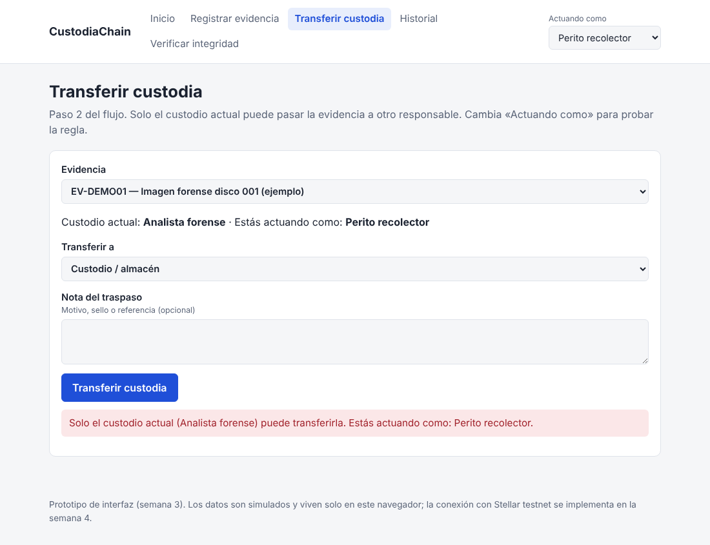
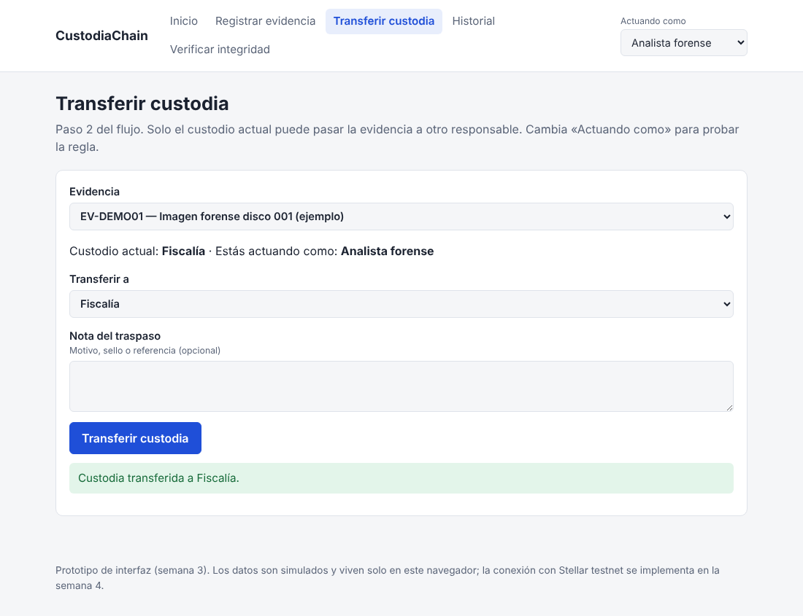
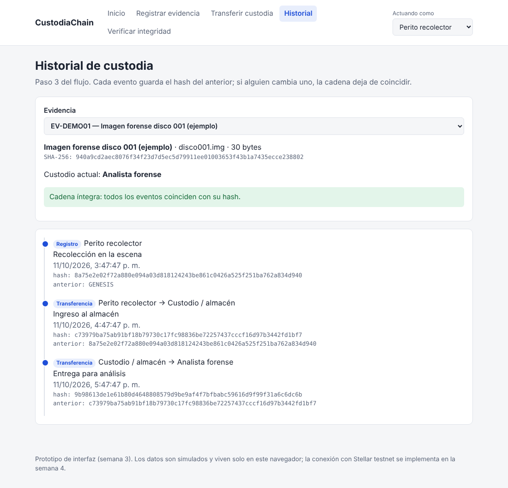
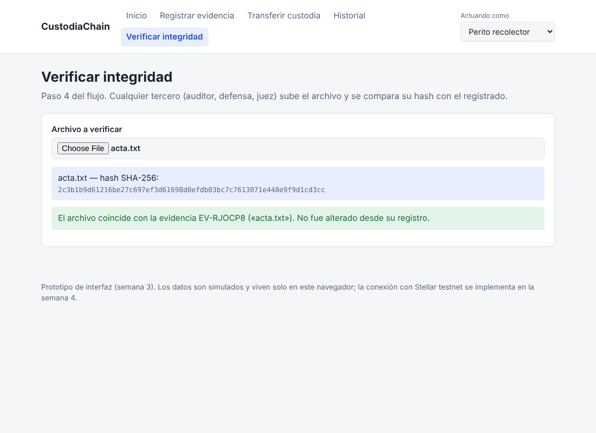
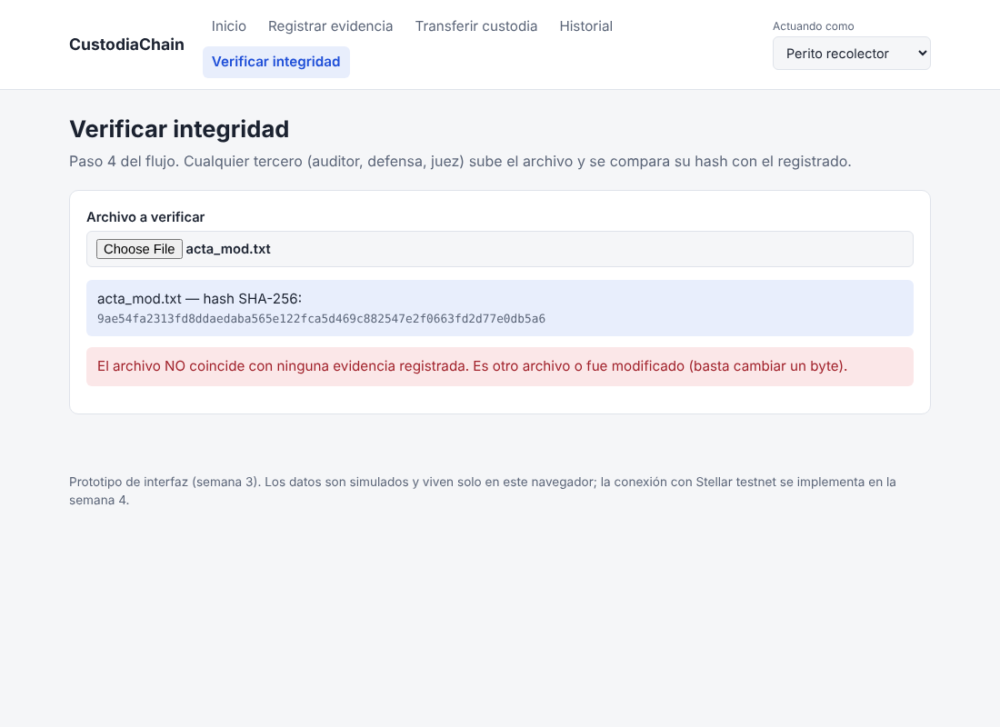

# Documentación Semana 3 — Functional Proof (CustodiaChain)

## Front construido.

El front vive en la carpeta `frontend/` del repositorio y está hecho con Next.js (App Router) y TypeScript. Implementa el flujo principal del MVP definido en el Product Blueprint (`docs/semana2/blueprint.md`, secciones 3 y 4): registrar evidencia, transferir custodia, consultar el historial y verificar la integridad. Las cuatro funciones del alcance del MVP quedan cubiertas por una pantalla cada una, más una pantalla de inicio. Para ejecutarlo, ver el README.

**Importante:** en esta semana los datos son **simulados**. Se guardan en el navegador (localStorage) y no se envían a ningún servidor ni a Stellar. La conexión con la red de pruebas (testnet) y los contratos corresponde a la semana 4.

### Pantallas y su relación con el Blueprint.

| Pantalla | Ruta | Paso del flujo del Blueprint | Qué hace |
|---|---|---|---|
| Inicio | `/` | — | Resume el flujo, muestra contadores y permite cargar datos de ejemplo o borrarlos. |
| Registrar evidencia | `/registrar` | 1. Recolección | El perito elige un archivo; el navegador calcula su hash SHA-256 (el archivo no sale del equipo) y se registra la evidencia con su primer custodio. |
| Transferir custodia | `/transferir` | 3. Transferencia de custodia | Pasa la evidencia a otro responsable. Solo el custodio actual puede hacerlo. |
| Historial | `/historial` | 4. Consulta (fiscalía/área legal) | Muestra cada evento en orden, con su hash y el hash del evento anterior, y recalcula la cadena para detectar alteraciones. |
| Verificar integridad | `/verificar` | 5. Verificación (auditor externo) | Un tercero sube un archivo; si su hash coincide con una evidencia registrada, se confirma que no fue alterado. |

### Cómo funciona

- **Participantes simulados.** El selector «Actuando como» (arriba a la derecha) permite simular a los cinco actores del Problem Brief: perito recolector, custodio/almacén, analista forense, fiscalía y juez. Es una lista fija, como se define en el alcance del MVP (la gestión granular de permisos quedó fuera).
- **Regla de transferencia.** Solo quien es el custodio actual puede transferir la evidencia. Es la misma regla que el Blueprint (sección 8) propone codificar en un contrato Soroban; en esta semana se aplica en la interfaz para dejar clara la lógica.
- **Cadena de eventos.** Cada evento guarda el hash del evento anterior (el primero usa `GENESIS`). Si alguien modificara un evento, el hash recalculado dejaría de coincidir y la pantalla de historial mostraría «Cadena alterada».
- **Verificación.** La comparación se hace por hash SHA-256: cambiar un solo byte del archivo produce un hash distinto y la verificación falla.

### Capturas de pantalla

### Estructura del código

- `frontend/app/`: una carpeta por pantalla (`registrar`, `transferir`, `historial`, `verificar`) más `page.tsx` (inicio) y `layout.tsx`.
- `frontend/lib/ledger.ts`: modelo de datos, hashes SHA-256, cálculo del custodio actual y verificación de la cadena.
- `frontend/components/`: navegación y proveedor del estado (registrar, transferir, datos de ejemplo).

## Decisión técnica

**Opción elegida: A — contrato propio (Soroban).** El equipo creará un contrato para la lógica de custodia. Esta semana solo se deja registrada la decisión; no se escribe ni se despliega código de contrato.

**Qué haría el contrato.** Para cada evidencia registraría su hash, su custodio actual y el historial de traspasos. Tendría dos operaciones principales: *registrar* (guarda el hash y asigna el primer custodio) y *transferir* (cambia el custodio, con la firma del custodio actual y la aceptación del destinatario). Cada operación emitiría un evento que cualquier tercero, como el auditor, puede consultar de forma independiente en la red.

**Por qué hace falta uno propio.** La regla central del producto es que una transferencia solo sea válida si quien transfiere es, en ese momento, el custodio registrado. Eso exige guardar un estado (quién custodia cada evidencia) y validarlo en cada operación. Es la razón por la que el Blueprint (sección 8) incluye Soroban: evitar que un error humano o una manipulación rompa la cadena. Una transacción simple de Stellar puede anclar un hash, pero por sí sola no impone esa regla de estado; habría que hacerla cumplir en un servidor propio, lo que reintroduce la confianza en un único administrador que el proyecto quiere eliminar (Problem Brief, criterio de pertinencia).

**Qué se descartó (opción B).** Se consideró apoyarse solo en operaciones nativas de Stellar o en un servicio ya existente del ecosistema. Se descarta como base del producto por lo anterior: no modelan la regla de «custodio actual». **Pendiente de verificación:** confirmar con Stellar Raven si existe algún servicio del ecosistema que ya cubra la custodia de evidencia; si lo hubiera, se reevaluaría la decisión.

**Apoyo en el Blueprint.** La decisión es coherente con el uso de Stellar definido en el Blueprint: cuentas como identidad de cada actor, transacciones firmadas como prueba de cada acción, Soroban como capa de reglas y red pública de pruebas (testnet) para que la verificación no dependa del equipo.

**Próximos pasos del contrato (semana 4).** Definir las funciones `registrar` y `transferir`, usar un constructor para inicializar (no una función `initialize` aparte), exigir autorización de las cuentas implicadas, escribir pruebas, desplegar en testnet y generar los bindings en TypeScript para conectarlos con este front.

## Participación del equipo

> Completar con los datos reales de cada integrante. Cada línea debe poder comprobarse en el historial de commits (`git log`).

| Integrante | Usuario de GitHub | Aporte / responsabilidad en este entregable |
|---|---|---|
| Sebastián Franco | sebasfrancogrs (confirmar) | Construcción del front (`frontend/`), README y esta documentación. Desarrollado con asistencia de IA (Claude), revisado y probado por el integrante. |
| Jonathan Agudelo | jbxmusic | _Pendiente de confirmar_ |
| Albeiro Crespo Gutierrez | galbeiroc | _Pendiente de confirmar_ |
| Tito Acosta | softven-digital | _Pendiente de confirmar_ |
| Johan Jimenez | jsebas2220 | _Pendiente de confirmar_ |

## Bloqueos y siguiente paso

**Qué quedó pendiente**
- Los datos son simulados: no hay conexión con Stellar testnet ni wallet.
- La decisión de contratos (opción A) debe ser validada por el responsable de Soroban del equipo.
- La participación de varios integrantes está por confirmar; esta entrega se realizó con poco tiempo y comunicación limitada del equipo.
- Pendientes de la semana 2: enlace al tablero Kanban y Lean Canvas en el Blueprint.

**Siguiente paso hacia el MVP**
1. Escribir y desplegar en testnet el contrato de custodia (sesión del martes sobre contratos).
2. Generar los bindings en TypeScript y reemplazar el almacenamiento local por llamadas al contrato.
3. Conectar una wallet para firmar registros y transferencias.
4. Validar el flujo completo con usuarios en la semana 4.
